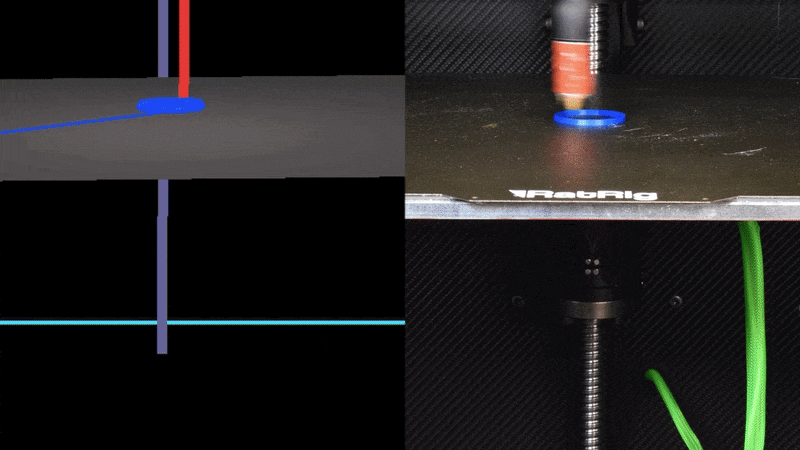
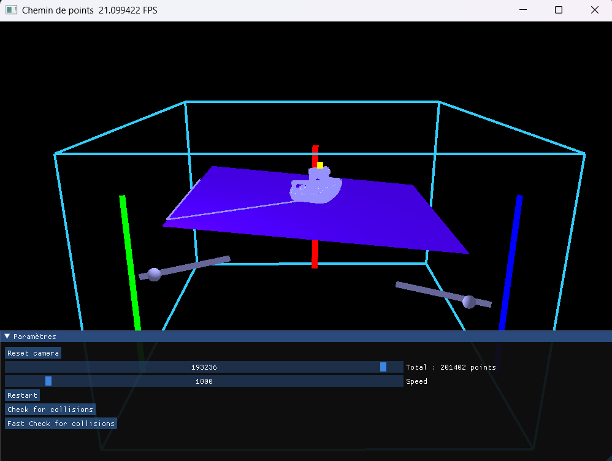

# Numerical twin of a 5-axis 3D printer

## Overview

Modifying a 3-axis printer to a 5-axis printer imposes limitations on the hardware and the prints that can be produced. Some of the toolpaths generated could theoretically damage the modified printer.

Creating a digital twin helps prevent errors by allowing you to preview the various movements of the printer and the extruded part.

The digital twin thus allows you to visualize, at every point along the toolpath, the position of the extruder, the orientation of the build plate, and the position and orientation of the part. However, it does not allow you to visualize the transitions between these states and does not take into account the print speed or the extrusion thickness.

## Demonstration

## Implementation

This project was creating using Python with the Taichi Lang.

### 5-Axis Toolpath Visualization

The numerical twin allows the visualization of the 3D printing operations directly from G-code (toolpath files).

- G-code parsing: Import and interpret G-code instructions to reconstruct the toolpath.
- 5-axis representation: Visualize the machine's configuration (position of each ball under the bed, rotation of the bed and position of the nozzle)

### Interactive 3D Visualization

The twin allows the user to precisely view the important parts of the printing process.

- Dynamic camera: The user can move inside the printer and rotate it.
- Time control: The user can change the speed of the visualization and jump to any step of the printing process.

### Collision Detection

The numerical twin can detect possible collisions. It will inform the user of the step which caused a collision and the location of the collision.

## Acknowledgements

I would like to thank **Xavier Chermain** and **Vincent Belle** for supervising this project, and to **Giovanni Cocco** for his technical guidance and support.

